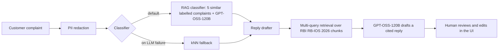

# 🏦 ComplaintIQ

**AI triage for banking complaints.** ComplaintIQ classifies a customer complaint into one of 10 product categories, then drafts a reply grounded in the **RBI Integrated Ombudsman Scheme 2026**, with a citation for every regulatory claim.

**Live demo:** https://complaintiq-shiney.streamlit.app


---

## Why this project

Banks receive thousands of free-text complaints. Routing them to the right team is slow and inconsistent, and replies must follow regulatory rules: when a customer may escalate to the RBI Ombudsman, within what time limits, and on what conditions. ComplaintIQ automates the first draft of both steps and keeps a human in the loop for the final decision.

## Results (all measured, not estimated)

### Classification: 200 held-out complaints, 10 balanced classes

| Method | Macro-F1 (95% CI) | Accuracy | Median latency | Cost / 1,000 complaints* |
|---|---|---|---|---|
| kNN (majority vote of 5 nearest labelled complaints) | 0.687 (0.619–0.741) | 0.700 | 0.045 s | $0 |
| Zero-shot LLM | 0.727 (0.661–0.783) | 0.730 | 0.63 s | $0.12 |
| **RAG (5 retrieved labelled examples + LLM)** | **0.786 (0.723–0.836)** | **0.785** | 0.87 s | $0.22 |

**Paired bootstrap significance test (same 200 complaints, 2,000 resamples):**

| Comparison | Δ macro-F1 | 95% CI | Significant? |
|---|---|---|---|
| RAG vs zero-shot | +5.9 pts | +1.0 to +11.5 | ✅ yes |
| RAG vs kNN | +9.9 pts | +3.3 to +16.9 | ✅ yes |
| Zero-shot vs kNN | +4.0 pts | −3.6 to +11.4 | ❌ no |

**Takeaway:** the LLM only became clearly worth its cost once it was grounded in labelled examples. RAG was the best method on 7 of 10 classes. It combined the dataset's labelling conventions, which kNN captures well (for example Debt collection), with the LLM's general knowledge, which helps rare classes (Prepaid card F1 rose from 0.33 with kNN to 0.62).

0% invalid outputs across all LLM runs (JSON mode plus validation against a fixed label set).

\*At Groq on-demand list prices at the time of evaluation ($0.15 / $0.60 per 1M input/output tokens for GPT-OSS-120B). The demo runs on the free tier.

### Reply drafting: LLM-as-judge faithfulness audit (20 replies, 63 regulatory claims)

| Metric | Result |
|---|---|
| Claims fully supported by retrieved RBI excerpts | 96.8% (upper bound, see below) |
| Replies with zero unsupported claims | 90% |
| Citation coverage / precision | 84.1% / 85.2% |
| Invalid citation numbers | 0 |
| Compensation promises / liability admissions | 0 / 0 |
| Replies within the 180-word limit | 100% (median 137 words) |
| End-to-end latency (redact → classify → retrieve → draft) | 2.7 s median, 4.2 s p95 |

**Judge validation:** I manually audited 12 claims and agreed with the judge on 9 (75%). The judge was **lenient**: it accepted claims that dropped a qualifier, such as applying a rule to the wrong party. This is consistent with self-preference bias, since the judge is the same model as the generator. So 96.8% should be read as an upper bound. Full review: [`results/judge_review.md`](results/judge_review.md).

---

## Architecture



- **`app/service.py`** is the single source of business logic, shared by the **FastAPI** backend (`app/api.py`) and the **Streamlit** UI (`streamlit_app.py`).
- **Two ChromaDB collections:** 3,838 labelled training complaints (for RAG classification and kNN) and 80 chunks of RBI policy text (for reply grounding).
- **Embeddings:** all-MiniLM-L6-v2 via ONNX Runtime (no PyTorch at runtime).

## Key engineering decisions

| Decision | Why |
|---|---|
| **Balanced test set + macro-F1** | Every category counts equally, so a model can't look good by only handling the biggest classes. |
| **Deduplication before splitting** | 939 duplicate narratives (~9%) were removed. Consumers often send the same text to several companies, which would have leaked test answers into the retrieval index. |
| **Code-enforced train/test separation** | An `assert` guarantees zero overlap; only the training pool is indexed. |
| **Multi-query policy retrieval + distance cutoff** | Issue-based queries retrieved irrelevant clauses (cosine similarity ≈ 0.47), which led the model to misapply a 15-day Ombudsman-process rule to the customer. Adding a fixed "escalation rules" query plus a similarity threshold fixed it. |
| **Citations verified in code** | Citation numbers are parsed from the reply text and checked against the retrieved sources, never trusted from the model's own list. |
| **Guardrails in the system prompt** | No invented rules or deadlines, no liability admissions, no compensation promises, complaint text treated as data (basic prompt-injection defence). |
| **PII redaction before any LLM call** | Emails, Indian mobile numbers, PAN, and card/account numbers are masked. Known trade-off: regex gives false positives on plain amounts. |
| **Graceful degradation** | If the LLM errors, is rate-limited, or returns an invalid label, the system falls back to kNN and says so (`degraded: true`). |
| **Low-confidence routing** | When fewer than 60% of kNN neighbours agree, the UI flags the case for human review. |
| **PyTorch → ONNX Runtime** | Needed to fit a free host. Re-running the kNN benchmark gave **identical predictions on all 200 complaints**; the trade-off is slower single-query embedding (≈45 ms → ≈240 ms), small next to LLM latency. |
| **Current regulation** | The knowledge base uses RB-IOS **2026**, which replaced the 2021 scheme from 1 July 2026. Grounding in the old scheme would produce outdated answers. |

## Data

- **Complaints:** [CFPB Consumer Complaint Database](https://www.consumerfinance.gov/data-research/consumer-complaints/) (public domain, CC0), via a [Hugging Face Parquet mirror](https://huggingface.co/datasets/Mouwiya/cfpb-consumer-complaints). The CFPB API silently ignored the narrative filter and blocked scripted requests, so the pipeline uses the mirror instead.
  - 750,000 rows → 10,543 with narratives → 9,305 after date filter, deduplication and minimum length → 10 classes.
  - Test set: 40 per class (400); evaluation subset: 20 per class (200); retrieval pool: up to 500 per class (3,838).
- **Regulation:** official RBI PDFs, the RB-IOS 2026 Scheme (24 pages) and its FAQs (10 pages).

**Why US complaints with Indian rules?** There is no large public labelled dataset of Indian banking complaints, so CFPB data was used to build and measure the classifier. The reply drafter targets the Indian market, and the complaint categories (cards, loans, accounts, credit reports) exist in both.

## Tech stack

Python 3.14 · Groq API (GPT-OSS-120B / 20B) · ChromaDB · ONNX Runtime (all-MiniLM-L6-v2) · pandas · pypdf · FastAPI · Pydantic · Streamlit · Docker · scikit-learn (evaluation)

## Run locally

```bash
git clone https://github.com/shineypriyanka/complaintiq.git
cd complaintiq
python -m venv .venv
# Windows: .venv\Scripts\Activate.ps1    macOS/Linux: source .venv/bin/activate
python -m pip install -r requirements.txt
cp .env.example .env        # then add your GROQ_API_KEY

# UI (builds the search indexes automatically on first run)
python -m streamlit run streamlit_app.py

# Or the API: interactive docs at http://127.0.0.1:8000/docs
python -m uvicorn app.api:app
```

**Reproduce the evaluation** (needs `requirements-dev.txt`):

```bash
python -m scripts.download_data        # CFPB shards from Hugging Face
python -m scripts.build_dataset        # clean, dedupe, stratified split
python -m scripts.build_index
python -m scripts.build_policy_index
python -m scripts.evaluate --method knn
python -m scripts.evaluate --method zero_shot
python -m scripts.evaluate --method rag
python -m scripts.report               # macro-F1, bootstrap CIs, paired tests
python -m scripts.eval_faithfulness    # LLM-as-judge audit of drafted replies
python -m scripts.report_faithfulness
```

Evaluation runs are resumable: results are saved per complaint, and the scripts stop cleanly at API rate limits.

## Project structure

```
app/
  service.py      shared triage logic (redact → classify → draft)
  api.py          FastAPI endpoints: /health, /classify, /triage
  classifier.py   zero-shot, RAG and kNN classifiers
  drafter.py      multi-query policy retrieval + cited reply drafting
  retriever.py    ONNX embeddings + ChromaDB search
  indexing.py     index building for complaints and RBI policies
  judge.py        LLM-as-judge for claim-level faithfulness
  pii.py          PII redaction
  llm.py, config.py, labels.py
scripts/          data pipeline, evaluation and reporting
data/processed/   train / test splits
data/policies/    RBI RB-IOS 2026 Scheme and FAQs
results/          raw evaluation outputs, summary.csv, judge_review.md
streamlit_app.py  web UI
Dockerfile, start.sh   containerised API + UI
```

## Limitations

- **Evaluation size:** 200 complaints for classification and 20 replies for faithfulness. Confidence intervals are reported for that reason.
- **Label noise:** CFPB categories are chosen by consumers, and some overlap (Checking/savings is the hardest class at 0.55 F1 even with RAG).
- **Severity has no ground truth** and varies between runs; treat it as a hint, not a measurement.
- **The faithfulness judge is lenient** (75% agreement with manual review); its score is an upper bound.
- **Narrow knowledge base:** only the Ombudsman Scheme and FAQs. The drafter cannot cite rules it hasn't been given, for example RBI guidelines on recovery agents' conduct.
- **Regex PII redaction** misses context-dependent PII and over-masks plain numbers.

## Future work

- Stricter judge rubric and a judge from a different model family
- Expand the knowledge base (recovery-agent guidelines, fair practices code), with the legal Scheme ranked above FAQs when they differ
- Cost cascade: accept kNN when all 5 neighbours agree and call the LLM only for uncertain cases (to be evaluated)
- Rubric-based severity with labelled examples
- Model-based PII detection

---

*Demo only. Not legal advice. Drafted replies must be reviewed by a human before sending.*